<div align="center">

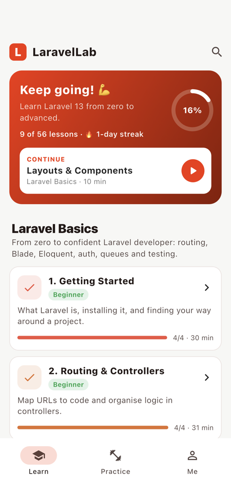

# LaravelLab

**Learn Laravel 13 from zero to advanced in a mobile app, offline.**

56 lessons across three courses (Basics, APIs, Advanced) with highlighted code, 140 quiz questions,
practice sessions, bookmarks, streaks and progress tracking. Built with Flutter for iOS and Android.


</div>

---

## Screenshots

<table>
  <tr>
    <td align="center"><br><sub><b>Learning path</b></sub></td>
    <td align="center">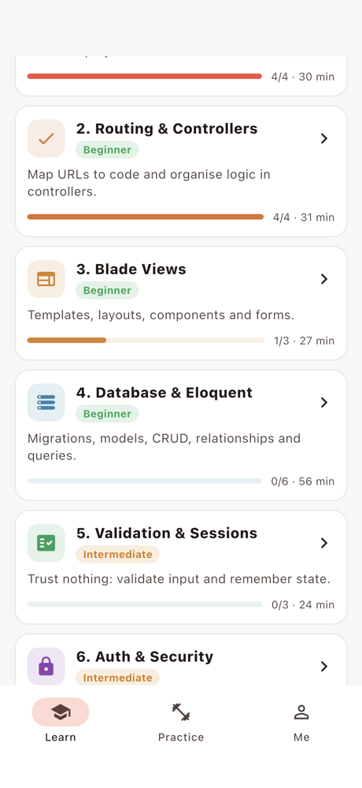<br><sub><b>Modules &amp; progress</b></sub></td>
    <td align="center">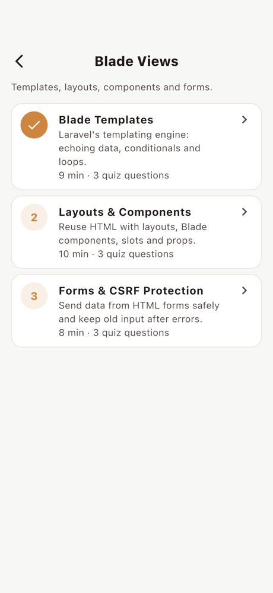<br><sub><b>Module lessons</b></sub></td>
    <td align="center">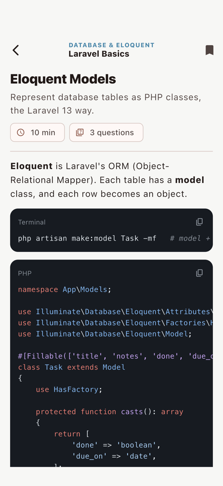<br><sub><b>Lesson</b></sub></td>
  </tr>
  <tr>
    <td align="center">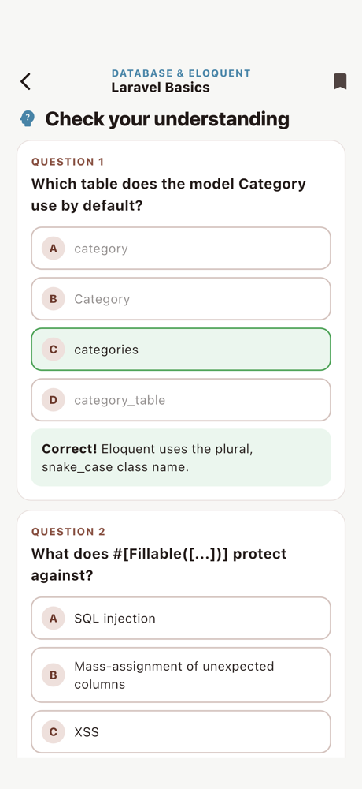<br><sub><b>End-of-lesson quiz</b></sub></td>
    <td align="center">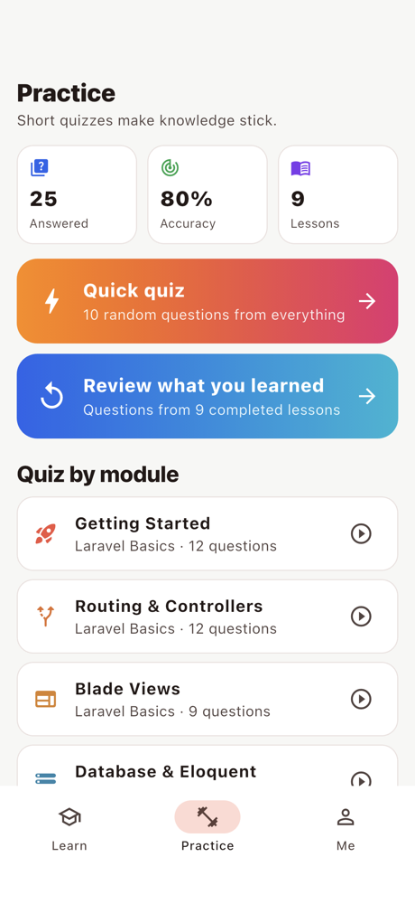<br><sub><b>Practice</b></sub></td>
    <td align="center">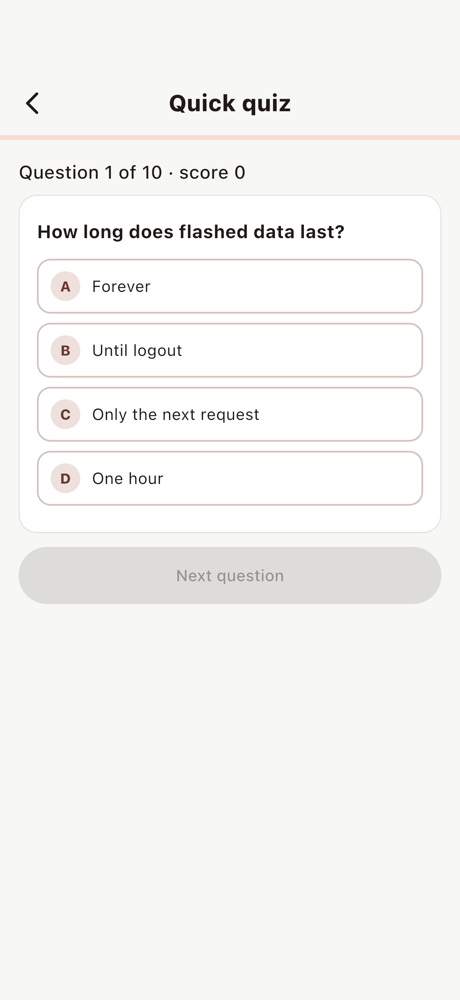<br><sub><b>Quick quiz</b></sub></td>
    <td align="center">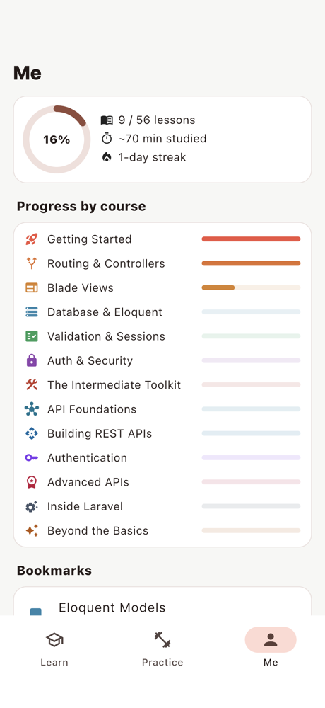<br><sub><b>Progress &amp; settings</b></sub></td>
  </tr>
  <tr>
    <td align="center">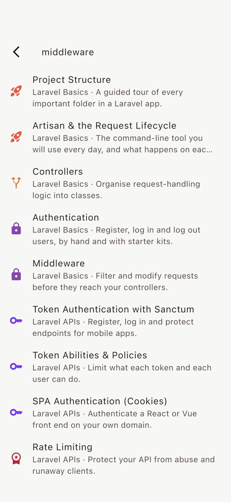<br><sub><b>Search</b></sub></td>
    <td align="center">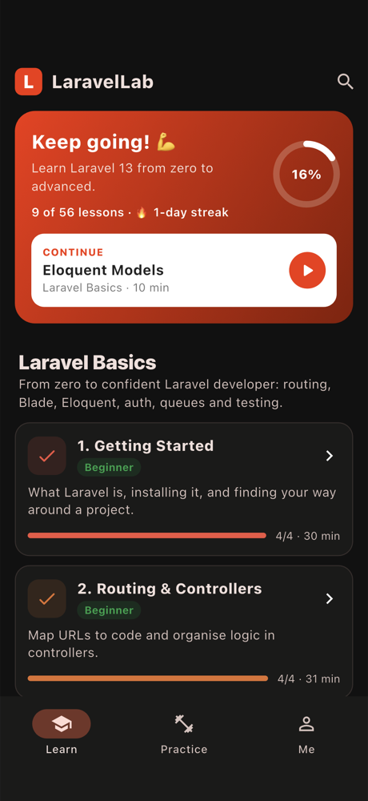<br><sub><b>Dark mode</b></sub></td>
    <td align="center">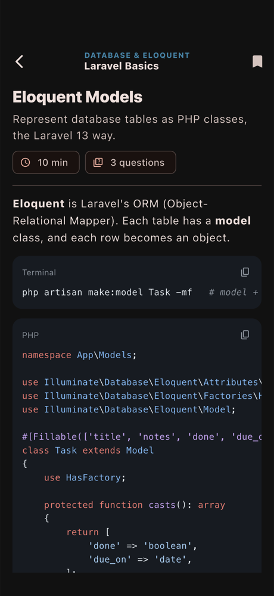<br><sub><b>Dark lesson</b></sub></td>
    <td></td>
  </tr>
</table>

---

## Curriculum

| Course | Modules | Lessons | Quiz Qs | Reading |
|---|---|---|---|---|
| **Laravel Basics** | Getting Started · Routing & Controllers · Blade Views · Database & Eloquent · Validation & Sessions · Auth & Security · The Intermediate Toolkit | 30 | 83 | ~4¼ h |
| **Laravel APIs** | API Foundations · Building REST APIs · Authentication (Sanctum) · Advanced APIs | 18 | 41 | ~2½ h |
| **Laravel Advanced** | Inside Laravel (Service Container, Providers & Facades, Collections) · Beyond the Basics (Livewire & Inertia, Broadcasting & Reverb, Structuring Bigger Apps, Security Checklist, The Ecosystem) | 8 | 16 | ~1 h |
| **Total** | 13 modules | **56** | **140** | **~8 h** |

Topics run from "What is Laravel?" and installing it through routing, Blade, Eloquent relationships, validation, auth,
policies, queues, events, testing and deployment, to REST design, Sanctum tokens, rate limiting, versioning, caching
and the service container.

## Features

- **Learning path** with a *Continue* card, overall progress ring, lesson count and daily **streak**
- **Lessons** with headings, lists, tables, tip/note/warning/analogy **callouts**, and dark **code blocks** with syntax highlighting, horizontal scroll and a **Copy** button
- **Quizzes** at the end of every lesson with instant feedback and an explanation for each answer
- **Practice tab:** a *Quick quiz* (10 random questions from everything) or *Review what you learned* (questions from completed lessons only), with your accuracy tracked
- **Me tab:** progress per module, minutes studied, bookmarks, **theme** (System / Light / Dark), **text size** and reset progress
- **Search** across every lesson's title, summary and content
- **Bookmarks**, *Mark complete & continue*, previous/next navigation
- **Fully offline:** all content ships as assets, and progress is saved on the device

---

## Getting started

### Prerequisites

- [Flutter](https://docs.flutter.dev/get-started/install) **3.47+** (Dart 3.13+)
- Xcode (iOS) and/or Android SDK (Android)

### Run it

```bash
git clone https://github.com/tejHacks/laravel_lab.git
cd laravel_lab
flutter pub get
flutter run                                   # pick a simulator, emulator or phone
```

### Build a release

```bash
flutter build apk --release --split-per-abi   # Android APKs
flutter build appbundle --release             # Play Store bundle
flutter build ipa --release                   # iOS (signing required)
```

### Test

```bash
flutter test
```

The tests parse **every lesson** and validate every quiz (answer index in range, question counts match the curriculum),
check that the Markdown parser handles every block type, start the app and visit each tab, and lay out **every lesson on
a small 360×740 phone at 100% and 130% text size** with no overflow errors.

---

## Editing the lessons

Lesson sources live in `tool/content/` as **bundles**: several lessons per file, each starting with a `=== FILE: slug.md ===` marker.

```
tool/content/basics_1.md  basics_2.md  basics_3.md   → Laravel Basics
tool/content/api_1.md     api_2.md                   → Laravel APIs
tool/content/advanced_1.md                           → Laravel Advanced
```

Each lesson is Markdown with front matter, callouts and a quiz block:

````markdown
=== FILE: what-is-laravel.md ===
---
title: What is Laravel?
summary: The PHP framework for web apps and APIs, and why developers love it.
minutes: 6
---
**Laravel** is a free, open-source PHP framework…

:::analogy
Building a web app from scratch is like making your own bricks first.
:::

```quiz
[{"q": "Laravel is a framework for which language?", "options": ["Python", "PHP", "Ruby", "Go"],
  "answer": 1, "why": "Laravel is written in and for PHP."}]
```
````

After editing, rebuild and validate:

```bash
python3 tool/build_lessons.py tool/content assets/lessons
```

This splits the bundles into `assets/lessons/<course>/<slug>.md`, writes each course's `curriculum.json` (module
order, levels, icons and colours are defined at the top of the script) and fails loudly on malformed lessons or quizzes.

> The same generated Markdown powers the **[Laravel Basics Lab](https://github.com/tejHacks/laravel_basics_lab)** and
> **[Laravel API Lab](https://github.com/tejHacks/laravel-api-lab)** websites. Copy `assets/lessons/basics` and `api` into their `resources/lessons`.

---

## Project structure

```
lib/
├── main.dart                 # Loads content + progress, applies theme and text scale
├── config.dart               # App name, brand colour, courses, interview asset: the only app-specific file
├── content/
│   ├── repository.dart       # Loads curriculum.json + lessons from assets, search
│   ├── markdown.dart         # Small Markdown parser → typed blocks (headings, lists, code, callouts, tables, quiz)
│   └── models.dart           # Course, Module, LessonInfo, Lesson, QuizQuestion, Block types
├── state/progress.dart       # Completed, bookmarks, streak, quiz accuracy, theme, text size (shared_preferences)
└── ui/
    ├── shell.dart            # Bottom navigation: Learn · Practice · (Interview) · Me
    ├── learn_screen.dart     # Learning path, module cards, module screen
    ├── lesson_screen.dart    # Lesson reader + quiz + next/previous
    ├── blocks_view.dart      # Renders parsed blocks
    ├── code_view.dart        # Highlighted code box with copy
    ├── quiz_card.dart        # Quiz question widget
    ├── practice_screen.dart  # Quick quiz, review, quiz sessions
    ├── interview_screen.dart # Interview Q&A + flashcards (hidden when there are no questions)
    ├── search_screen.dart
    ├── me_screen.dart
    └── theme.dart
assets/lessons/{basics,api,advanced}/   # Generated lessons + curriculum.json
tool/build_lessons.py                   # Bundle → lessons builder and validator
```

### One engine, many course apps

Everything except `lib/config.dart` and the content is generic. The same engine powers
**[SwiftLab](https://github.com/tejHacks/swfit-lab)**, which adds interview questions in `assets/interview/questions.json`.
Fill that file here and an **Interview** tab with flashcard drills appears automatically.

---

## License

This project is currently unlicensed. All rights reserved by the author.
